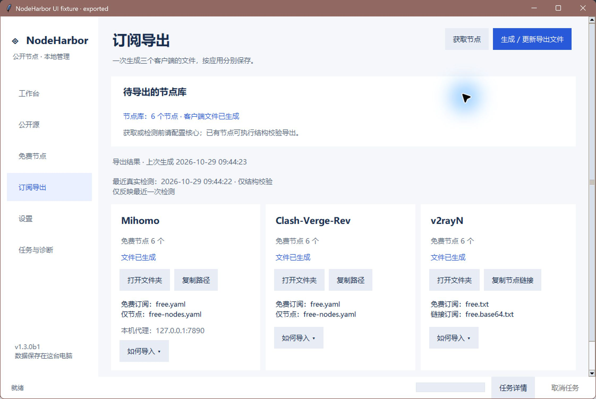

# NodeHarbor · 节点港

在本机发现公开免费节点、检查可用性，并导出给 Mihomo、Clash-Verge-Rev 和 v2rayN。

**Windows x64 / Python 3.10+ · GPL-3.0-only**

[下载 Beta 2](https://github.com/Aenica-Rinko/nodeharbor/releases/tag/v1.3.0-beta.2) · [详细使用指南](docs/user-guide.md) · [验收范围](docs/acceptance.md)

当前版本为 **v1.3.0-beta.2**（预发布测试版）；应用和 Python 包版本为 `1.3.0b2`。

## 四步开始

1. **准备程序**：下载 Windows ZIP，完整解压，运行 `NodeHarbor.exe`，保留同目录的 `_internal`。
2. **配置检测核心**：在设置里选择已有客户端主程序或核心文件，点击“检查核心是否可用”，成功后保存。没有客户端可使用设置页的官方下载。
3. **获取节点**：在“公开源”启用来源，点击“获取节点”。这一步更新内部节点库，不生成客户端文件。
4. **导出使用**：在“订阅导出”点击“生成 / 更新导出文件”，在对应客户端卡片打开文件夹或复制链接，再按“如何导入”操作。

截图使用虚构节点，展示 2026-10-29 基于 Beta 1 改进的开发界面，不代表真实节点可用性。

## 如何理解结果

- 下载成功只说明拿到了订阅；节点是否可用，要看检测结果。
- 节点详情区分本轮沿用历史、最近实测时间、单次检测轮数和跨次记录。
- 来源详情显示本轮候选与保留数量、历史复用和重复比例；独有节点不等于独有可用节点。
- 检测通过不代表下载速度、UDP/QUIC 支持或长期稳定。公网长期稳定性和完整协议流量矩阵仍需继续验收。
- Cloudflare 分类指第三方订阅托管位置。搜索在 GitHub 公开说明中发现 Workers/Pages 链接，不是 Cloudflare 官方节点目录，也不是全网搜索。

## 更新与隐私

获取、导出是两个独立动作。更新导出后，本地文件导入的客户端需要再次导入；v2rayN 粘贴会追加节点，旧节点不会自动删除。经常更新可使用设置页的本地订阅地址，更新时需保持 NodeHarbor 运行。

程序不随包提供检测核心、个人配置或真实节点。打开应用不会自动联网或修改系统代理。配置、来源记录、节点和导出保存在本机；诊断报告需由用户主动生成和分享。

## 文档与开发

- [完整指南：来源搜索、检测、客户端导入、命令行](docs/user-guide.md)
- [新用户试用任务与记录表](docs/usability-check.md)
- [架构说明](docs/architecture.md) · [界面规范](docs/ui-layout.md)
- [验收记录](docs/acceptance.md) · [安全说明](SECURITY.md) · [贡献指南](CONTRIBUTING.md)

源码启动：运行 `scripts/windows/setup.cmd` 后双击 `Start.cmd`。测试使用 `python -B -m pytest -q -p no:cacheprovider`，独立界面检查使用 `python -B scripts/windows/check_ui.py`。

发布与打包见 [发布流程](docs/releasing.md)。请勿直接压缩个人工作目录发布。
