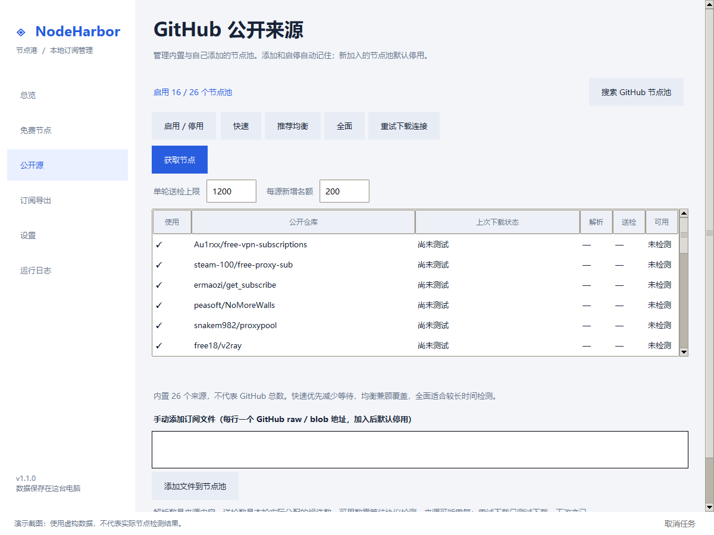
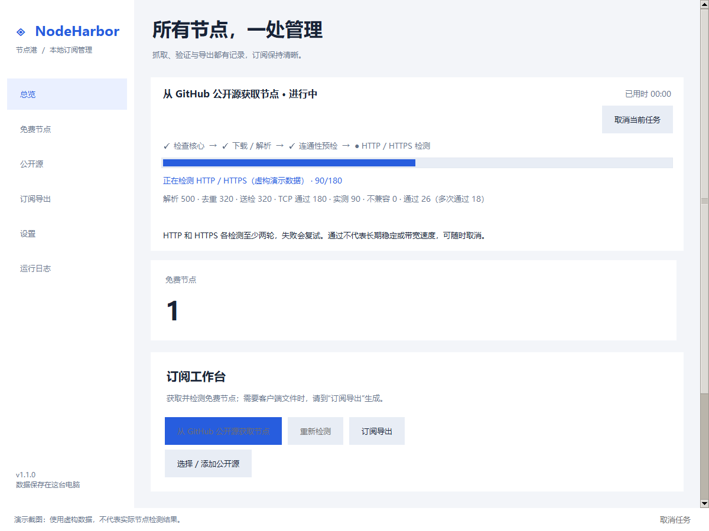

# NodeHarbor · 节点港

帮助用户获取 GitHub 公开免费节点、检测可用性，并导出给 Mihomo、Clash-Verge-Rev 和 v2rayN。

**v1.1.0 · Beta · Windows x64 / Python 3.10+ · GPL-3.0-only**

[下载 Windows 完整 ZIP](https://github.com/Aenica-Rinko/nodeharbor/releases/download/v1.1.0/NodeHarbor-1.1.0-windows-x64.zip) · [版本说明与校验文件](https://github.com/Aenica-Rinko/nodeharbor/releases/tag/v1.1.0)


## 开始使用

1. 完整解压 Windows ZIP，打开 `NodeHarbor.exe`。源码用户运行 `scripts/windows/setup.cmd` 后双击 `Start.cmd`。
2. 在设置中选择检测客户端及核心。可选择真实核心，也可选择客户端主程序，让应用在安装目录内查找核心。
3. 在“公开源”选择来源，点击“获取节点”。应用下载、去重、检测，仅更新内部节点库。
4. 打开“订阅导出”，点击“生成 / 更新导出文件”，再打开对应客户端目录导入。

官方来源：[Mihomo](https://github.com/MetaCubeX/mihomo/releases)、[Clash-Verge-Rev](https://github.com/clash-verge-rev/clash-verge-rev/releases)、[v2rayN](https://github.com/2dust/v2rayN/releases)。Mihomo 不随发布包提供，需自行下载或使用已有客户端内置核心。

公开版本以 [Releases](https://github.com/Aenica-Rinko/nodeharbor/releases) 为准。打开应用不会自动联网，也不会修改系统代理。

## 获取公开来源

内置 26 个仓库，提供快速（6 源）、推荐均衡（16 源）、全面（26 源）三种预设。此目录不是 GitHub 上全部免费来源，也不保证每个来源持续可用。已有手动选择会保留，可在“公开源”页切换预设，来源选择自动记住。预设仅调整内置来源，不会自动启用新加入的节点池。

“公开源”页支持启停内置来源，以及添加无需 Token 的 GitHub raw / blob 公开文件地址。不接受私人订阅地址、查询参数或认证信息。

点击“搜索 GitHub 节点池”，输入 `免费节点`、`free v2ray`（免费的 V2Ray 节点）等关键词。搜索框默认为空，示例不是固定来源。选择仓库后，可点击“打开仓库说明”右侧的“加入 NodeHarbor 节点池”，立即加入公开源列表，默认停用。再查看候选订阅文件，选中后点击“使用选中的订阅文件”，回到列表手动启用；添加、文件选择和启停自动记住，无需另点“保存来源”。未选文件的节点池不能启用，再次启用会打开文件选择窗口。

搜索按最近更新列出最多 20 个仓库，每个仓库最多列出 100 个候选文件；它们尚未经过节点检测，也不代表 GitHub 上的全部节点池。搜索使用匿名 GitHub API 和应用的下载代理设置，遇到限流时会明确提示；不需要登录或 Token。可打开仓库说明确认文件用途。

任务进度卡片有“取消当前任务”，搜索窗口有“取消搜索”。取消会中断正在执行的网络工作进程，保留已经保存的来源与现有导出。



来源表实时显示连接、下载大小、解析、下载通道，以及解析数、送检数和最近检测可用数。详情包含独有数和检测时间；独有数表示只在该来源出现的节点，来源之间共享的节点只检测一次。下载成功不等于节点可用；只测试下载时，可用数显示“未检测”。

按本机历史检测成功率安排获取顺序，每个来源轮流贡献检测候选，避免大型来源占满名额。快速最多送检 400 个、单源贡献最多 100 个；推荐均衡为 1200 / 200；全面为 4000 / 400。可修改名额。达到限制的其余来源节点仍保存在缓存，界面会显示未送检数；单源贡献名额不包含其他来源已贡献的重复节点。

下载保留 TLS 校验。原始地址失败时，内置来源可尝试公开 CDN 和 GitHub Contents API。设置中的下载代理用于公开源搜索和订阅获取；留空使用环境或系统代理。开启自动回退后，公开源连接失败可尝试少数正在运行的本机 HTTP 代理端口。

公开文件默认缓存 10 分钟，过期后使用 ETag / Last-Modified 校验。下载失败可使用不超过 24 小时的旧缓存，并明确标注后重新检测。连续失败的来源逐步延长重试间隔；限流时遵循等待信息。“重试下载连接”绕过缓存有效期和来源退避，但仍会遵守 GitHub API 的限流等待。查看来源详情可了解实际下载通道、最近成功时间及下次重试时间。

同时最多下载 8 个来源（默认 6 个），每个源默认最多 60 秒，整轮任务默认 30 分钟。启用历史补充时最多预留总名额的五分之一、上限 200 个，用于重新检测历史可用节点，优先低延迟节点。全部来源无数据时可重新检测历史节点，界面明确提示“没有取得新数据”。没有节点通过时保留当前导出；取消不会触发历史回退。

## 检测标准

先进行 TCP 预检；UDP 协议直接进入核心检测。核心不兼容的节点单独计入“不兼容”，不计入实测数量。

每个节点默认测试一个 HTTP 地址和一个 HTTPS 地址，重复两轮，每轮失败复试一次。只有一轮中的两个地址都返回 2xx 成功状态且延迟不超过阈值，该轮才成功。Mihomo 同时核对对应测试地址的详细状态，不能仅凭延迟接口的成功返回判断节点可用。

- **多次通过**：两轮都成功（允许失败复试后成功）。
- **部分轮次通过**：只有一轮成功，仍可导出，列表明确标注。
- **未通过**：没有完整成功轮次，不进入新导出。

默认单请求限时 6 秒、延迟阈值 5 秒。延迟是测试请求响应时间，不是带宽速度；多次通过只反映本次测试，不保证长期稳定或特定网站可访问。节点名称中的地区只是标签推断，不是真实定位。



界面分别显示解析、去重、TCP 通过、实测、不兼容、最终通过和多次通过数量。检测结果记录真实检测时间；重新导出不会更新它。节点库支持按延迟、名称、来源排序，搜索不会反复读取订阅文件。

网络检测使用可复用的隔离工作进程，支持硬超时和取消；发送请求、DNS 查询、下载和探测均受取消控制。格式错误的单个分享链接、传输参数或损坏的来源健康缓存不会让正常来源整批失效。检测核心独立运行，禁止 TUN，不占用已有客户端的控制接口。核心错误只显示分类和退出码，不输出原始节点、路径或认证信息。

Mihomo 支持其版本可接受的协议；Xray 适配支持可转换的 SS（无插件）、VMess、VLESS、Trojan、SOCKS5、HTTP，以及相应 TCP / WebSocket / gRPC、TLS / Reality 参数。其余协议或参数明确跳过，可切换 Mihomo 检测。

## 导出和导入

主操作只有“从 GitHub 公开源获取节点”和“生成 / 更新导出文件”。获取只下载、检测并更新内部节点库，不改变客户端导出文件；生成 / 更新导出文件才会使用节点库生成三个客户端的文件，不重新联网检测。总览另有“重新检测”辅助操作，同样只更新节点库。界面会提示节点库是否有更新待导出。

| 客户端目录 | 文件 | 用法 |
| --- | --- | --- |
| Mihomo | `free.yaml`、`free-nodes.yaml` | 完整 YAML 带本机混合代理端口；以 `mihomo -f free.yaml` 启动，软件代理连接页面显示的端口 |
| clash-verge-Rev | `free.yaml`、`free-nodes.yaml` | 在订阅页导入本地配置并启用；不写入客户端代理端口 |
| v2rayN | `free.txt`、`free.base64.txt` | 复制分享链接，在 v2rayN 从剪贴板导入；Base64 文件是链接订阅 |

Mihomo 独立代理默认监听 `127.0.0.1:7890`，可在设置修改后重新导出。端口冲突需自行处理，应用不会终止其他客户端。

每个目录都有 `report.json`。完整版本保存在导出根目录的 `.history`（默认目录则直接保存版本），当前指针只在全部文件就绪后切换。切换前取消会保留原版本；切换完成后视为成功，稍晚的取消或历史清理失败不会将已生效的导出显示为失败。保存文件后可关闭 NodeHarbor，客户端仍可使用。

v2rayN 转换支持 SS、VMess、VLESS、Trojan、Hysteria2、TUIC、SOCKS5、AnyTLS 和单对端 WireGuard 的可转换参数。无法完整转换的节点会跳过，并显示数量和原因；完整节点仍保留在 YAML。格式参考 [v2rayN 订阅说明](https://github.com/2dust/v2rayN/wiki/Description-of-subscription)。

已有节点时，缺少检测核心仍可执行结构校验导出；页面明确显示“仅结构校验”，不宣称通过 Mihomo 检查。检测与获取仍要求可用核心。

## 本地订阅地址

设置页可启动本机服务并复制对应格式地址，默认监听 `127.0.0.1:8199`。服务支持 GET / HEAD，只接受本机 Host，拒绝指向其他位置的链接文件，并限制连接等待时间。更新订阅时需保持 NodeHarbor 运行，地址不能用于另一台设备，同机其他进程可能读取订阅。

| 地址 | 内容 |
| --- | --- |
| `/free.yaml` | Clash-Verge-Rev 完整配置 |
| `/free.mihomo.yaml`、`/mihomo.yaml` | Mihomo 独立运行配置 |
| `/free-nodes.yaml` | 纯节点 YAML |
| `/free.v2ray.txt` | v2rayN 分享链接 |
| `/free.v2ray.base64.txt` | v2rayN Base64 链接订阅 |

Gist 上传、私人订阅输入和 Base64 YAML 导出已移除。旧的本地私人配置保留，但不再被应用读取；已存在的旧导出不会被升级扫描删除。不在服务白名单的路径返回 404。

## 配置与数据

首次运行只创建 `config/settings.yaml`。Windows EXE 默认数据目录是 `%LOCALAPPDATA%\NodeHarbor`，源码默认使用项目目录；可用 `NODEHARBOR_HOME` 或命令行 `--home` 覆盖。

- `config/settings.yaml`：公开源选择、下载代理、核心路径、检测标准和导出位置。
- `data/state/`：运行结果、来源状态。
- `data/source-cache/`：公开源内容缓存及健康记录，含节点认证信息，仅保存在本机。
- `logs/`：轮转运行日志。
- `runtime/`：用户自行提供的核心。

`exports.directory` 留空使用默认导出位置；设置中可选择独立目录，按三个客户端分文件夹。目录迁移只复制免费节点数据，原文件保留。真实配置、缓存、导出、日志、备份和核心二进制均被排除在 Git 和发布包之外。

更多参数：`fetch.cache_minutes`（默认 10，0 为每次请求）、`fetch.source_timeout_seconds`（60）、`task.timeout_seconds`（1800）、`verification.https_test_url`、`verification.rounds`（2）、`verification.retry_failed`（1）、`exports.mihomo_port`（7890）、`exports.keep_generations`（5，最少 2）。测试 HTTPS 地址必须为 HTTPS；核心路径按三个客户端分别保存。`verification.timeout_ms` 默认 6000；Mihomo 检测最大 32767，Xray 最大 60000，超出核心接口范围会明确拒绝，避免全部节点被误判失败。

桌面获取与检测结果保存在数据目录的 `data/library/free.json`，与客户端导出分开。首次升级时兼容读取既有导出作为节点库；获取失败或取消时保留上次节点库和导出。命令行可用 `acquire`、`verify-library`、`export` 分别完成获取、重新检测与导出；旧 `refresh`、`refresh-github`、`verify` 组合命令保留兼容行为。

## 命令行与开发

```powershell
python -m pip install -e ".[dev]"
python NodeHarbor.py init
python NodeHarbor.py gui
python NodeHarbor.py acquire
python NodeHarbor.py verify-library
python NodeHarbor.py export
python NodeHarbor.py serve
python NodeHarbor.py doctor
python NodeHarbor.py status
python -B -m pytest -q -rs -p no:cacheprovider
python scripts/release.py --check
```

`refresh` 保留为 `refresh-github` 的兼容命令。失败退出码为 1，中断为 130。Linux/macOS 可运行 CLI，GUI 需要 Tcl/Tk 和图形会话，主要验证平台为 Windows。

结构为 `src/nodeharbor/`、`tests/`、`scripts/`、`docs/`、`.github/` 和空白配置示例。架构见 [架构说明](docs/architecture.md)，发布流程见 [发布说明](docs/releasing.md)。

构建 Windows EXE：安装 `.[windows]`，运行 `python scripts/windows/build_exe.py`，再运行 `python scripts/windows/check_exe.py <构建出的 NodeHarbor 目录>`。构建只使用通过隐私审计的源码副本。禁止直接压缩整个工作目录发布。

## 许可证

[GNU GPL v3.0 only](LICENSE)。第三方许可见 [THIRD_PARTY_NOTICES.md](THIRD_PARTY_NOTICES.md)。
